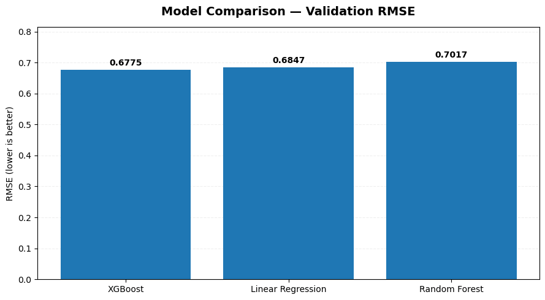
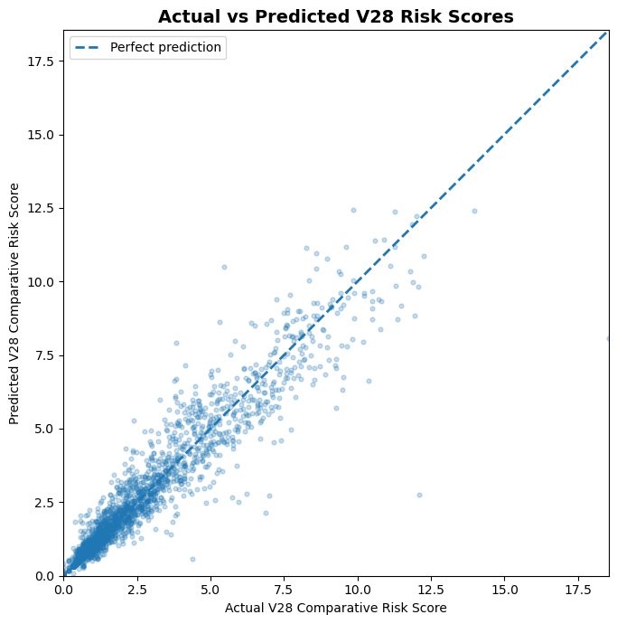
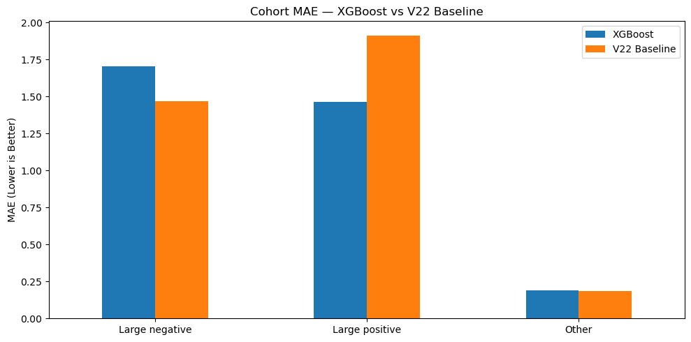

# CMS-HCC V22 to V28 Risk Transition Simulator

A Microsoft Fabric analytical workflow for comparing CMS-HCC V22 and V28 risk scores using CMS DE-SynPUF sample claims data. The project moves source records through Bronze, Silver, and Gold layers, produces a member-level V22/V28 comparison, and evaluates a model that estimates the standardized V28 score from V22-era features.

> **Data boundary:** This repository contains code, a logical pipeline template, table definitions, and aggregate evaluation results only. It contains no source records, member identifiers, mapping files, credentials, Fabric workspace identifiers, or saved notebook outputs.

## What is included

| Area | Contents |
| --- | --- |
| `notebooks/` | Cleaned Fabric notebooks for ingestion, transformation, dimensional modeling, and risk-model analysis |
| `pipeline/` | A portable logical pipeline template with no tenant, workspace, or notebook IDs |
| `docs/data-model.md` | Gold-layer dimensions and facts, including table grain |
| `docs/data-lineage.md` | Bronze → Silver → Gold lineage and source-data boundary |
| `docs/ml-evaluation.md` | Saved aggregate evaluation evidence and limitations |
| `docs/architecture.md` | Publication and data-handling boundaries |

## Workflow

**Approved CMS DE-SynPUF sample files and versioned references** → **Bronze ingestion and validation** → **Silver clinical transformations** → **Gold dimensional model** → **V22-to-V28 risk analysis** → **aggregate transition and diagnostic facts**

1. **Bronze** — validate and load beneficiary, inpatient, outpatient, GEM, and HCC mapping reference files as Delta tables.
2. **Silver** — standardize claim diagnosis evidence, map ICD-9 to ICD-10, apply V22 and V28 HCC mappings, and calculate member risk features.
3. **Gold** — publish member, model, and HCC dimensions plus member-risk and member-HCC facts.
4. **Analysis** — compare standardized scores and train/evaluate an XGBoost estimate of the V28 score.

## Model evidence captured from the supplied notebook

The notebook uses a member-isolated train/validation/test split: 81,387 training rows, 17,677 validation rows, and 17,288 held-out test rows. XGBoost was selected by validation RMSE.

| Evaluation stage | Model | MAE | RMSE | R² |
| --- | --- | ---: | ---: | ---: |
| Validation | XGBoost | 0.3249 | 0.6775 | 0.9087 |
| Held-out test | XGBoost V2 | 0.3269 | 0.6925 | 0.9085 |
| Held-out test | V22 score baseline | 0.3465 | 0.7207 | 0.9009 |

On the held-out test population, XGBoost reduced RMSE by **3.90%** versus directly using the V22 score. It achieved **64.61% transition-direction accuracy** using the notebook's neutral band, and used a **0.9900** score-change threshold to identify large transitions.

These are historical notebook outputs, not a claim of production performance. See [docs/ml-evaluation.md](docs/ml-evaluation.md) for the complete aggregate evidence and important limitations.

## Visualizations and how to read them

The three charts below are the HCC figures from the supplied presentation document. They contain aggregate metrics or de-identified score plots only; no member identifiers, raw records, or notebook outputs are published. The notebook can regenerate the full diagnostic set in an approved Fabric environment.

### Model selection

XGBoost had the lowest validation RMSE (**0.6775**), narrowly outperforming linear regression (**0.6847**) and random forest (**0.7017**). Since lower RMSE means fewer large score-estimation errors, this chart provides the model-selection evidence.

### Held-out score agreement

The dashed diagonal is perfect prediction. Most plotted observations follow that diagonal, consistent with the held-out test **R² of 0.9085**. Points farther from the line represent larger individual score-estimation errors. The chart uses a display sample; the metrics use all 17,288 held-out test rows.

### Transition-cohort limitation

This diagnostic prevents the aggregate score from hiding uneven performance. XGBoost improves MAE for large positive transitions (**1.47 vs 1.91** for the V22 baseline), but is worse for large negative transitions (**1.70 vs 1.46**). This limitation is documented explicitly: strong overall performance does not make every transition type equally reliable.

| Visualization | What it shows | How to interpret it |
| --- | --- | --- |
| Validation RMSE comparison | RMSE for XGBoost, linear regression, and random forest during model selection | Lower bars are better. This is the primary selection chart; it supports selecting XGBoost using validation data only. |
| Validation R² comparison | Variance explained by each candidate on validation data | Higher bars are better. Use it alongside RMSE rather than as the sole selection measure. |
| Test RMSE: XGBoost vs V22 baseline | Independent test error of the selected model compared with the unadjusted V22 score | Lower XGBoost RMSE shows incremental predictive value beyond carrying forward the V22 score. The chart annotates the 3.90% reduction. |
| Actual vs predicted V28 score | A sampled scatterplot of up to 3,000 held-out members against the perfect-prediction diagonal | Points closer to the diagonal have smaller error. Sampling improves legibility; reported metrics always use all 17,288 test rows. |
| Residual distribution | Histogram of `actual V28 − predicted V28` | A distribution centered near zero indicates limited average bias; its spread and tails show how large errors can become. |
| Feature importance | Relative XGBoost feature importance for the seven supplied inputs | Identifies inputs used most by this model. It is not a causal explanation and should not be treated as clinical importance. |
| Actual vs predicted mean transition | Mean V22→V28 change across large-negative, large-positive, and other transition cohorts | Shows whether the estimated transition direction and magnitude track observed cohort-level changes. |
| Cohort MAE comparison | XGBoost versus V22-baseline error by transition cohort | Identifies where the model adds value or underperforms. The supplied analysis reported better large-positive estimation but weaker large-negative estimation, so this chart is essential for responsible interpretation. |

## Metric definitions

- **MAE:** average absolute score error; lower is better.
- **RMSE:** error measure that penalizes larger misses more strongly; lower is better and was the selection metric.
- **R²:** proportion of variation explained by the estimate; higher is better.
- **Direction accuracy:** percentage of members for whom the predicted transition class matches the actual class (decrease, stable, or increase).
- **Cohort MAE and residuals:** diagnostic measures used to identify uneven performance across transition patterns.

## Gold model

The Gold layer contains `dim_member`, `dim_model`, `dim_hcc`, `fact_member_risk`, and `fact_member_hcc`. It also publishes aggregate model-evaluation and transition-analysis facts. See [docs/data-model.md](docs/data-model.md).

## Running in Microsoft Fabric

1. Obtain approval to use only authorized, de-identified or synthetic data.
2. Configure the raw and reference paths in the Bronze notebook for your Lakehouse.
3. Attach a Lakehouse and execute the notebooks in numeric order.
4. Use `pipeline/hcc_v22_to_v28_pipeline.template.json` as a logical implementation guide; replace the notebook references with items in your own workspace.
5. Reconcile results against approved CMS reference logic before any operational use.

## Scope and limitations

This is an analytical comparison project, not clinical, coding, reimbursement, eligibility, or payment advice. The provided workflow is based on CMS DE-SynPUF sample data and needs governance, version-controlled reference mappings, testing, fairness review, and independent validation before any real-world decision use.

## Runtime

Designed for Microsoft Fabric Spark. See [requirements.md](requirements.md) for packages referenced by the supplied notebooks.

